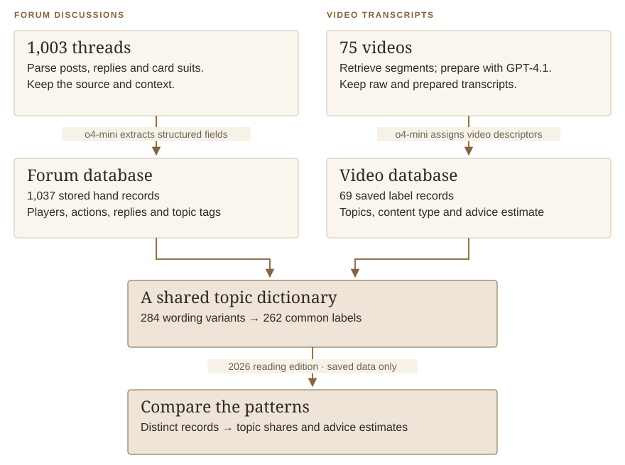
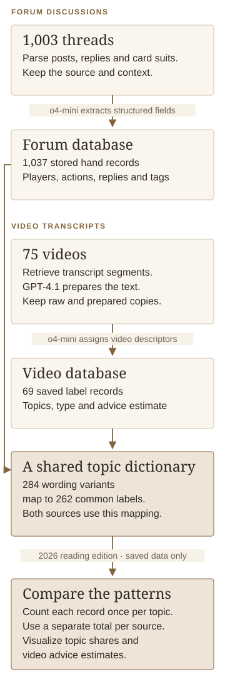

# Poker strategy: from text to analysis

**Elias Brown · Python, web scraping, language-model extraction, SQLite & visualization · Individual project, 2025**

When poker players ask for help, are they talking about the same situations that strategy videos teach? I built a workflow to explore that question: collect the discussions and transcripts, turn their stories into organized records, and compare the topics they contain.

The clearest finding is **shared attention to common betting decisions**. Betting again after an earlier raise, responding to a re-raise, and playing a pot with one initial raise all feature prominently in the saved labels. The data lets us describe that overlap; it does not tell us whether watching a video changed anyone's play.

I was the sole contributor to the original project. My work covered collection, transcript preparation, extraction prompts, relational database design, topic mapping, SQL analysis, and six exploratory visualizations. The resulting data connects a discussion to its hands, participants, betting rounds, comments, and strategy labels.

<strong>1,003</strong>forum threads collected

<strong>75</strong>video transcripts collected

<strong>1,036</strong>distinct extracted hand records

<strong>5,063</strong>hand–topic associations

Counts describe the saved project data. The reading edition merges one exact duplicate among 1,037 stored hand records. Model-generated fields have not been independently annotated for accuracy.

## The analytical question

The original presentation started with a practical problem: a player can follow advice and still struggle to explain a loss, while a creator may not know which situations their audience finds confusing. Winning or losing a single hand does not, by itself, explain the quality of the decision. I wanted to bring the teaching and the players' accounts into the same frame.

Poker discussions describe decisions in context: a player's position, the size of the pot, the cards on the board, an opponent's actions, and the reasoning behind a call or a fold. Instructional videos describe some of the same situations through advice and examples. Both sources are rich in detail, but their content begins as narrative text.

The project asked which situations recur in those sources and how they can be compared. Answering that required a way to identify the entities inside the text, retain their relationships, and recognize differently worded strategy labels as the same topic.

For a creator, that could help identify discussion examples worth addressing in a lesson. For a learner, it could help group similar decisions for study. The delivered project builds the data foundation and explores the patterns; testing whether those uses improve learning would require further work.

## From poker stories to comparable evidence

The two sources begin in different forms: players recount individual decisions, while a creator explains strategy. The workflow preserves those differences and gives their topics a common set of names. Follow the arrows to see how the sources become comparable.

<figure class="analysis-figure diagram-figure"><figcaption><strong>Workflow.</strong> Collection, model extraction, storage and topic mapping were part of the original 2025 project. The 2026 analysis at the bottom uses saved data only. It merges one exact duplicate among the 1,037 stored hand records.</figcaption></figure>

The collection stage preserved details that ordinary text extraction can lose, including card suits, quoted replies, and whether a comment came from the original poster. The database separated hands from discussions and players from hands, allowing a thread to describe more than one hand and a hand to carry several strategy labels.

[Explore the pipeline and data model →](docs/METHODS.md)

## A shared center of attention

Three everyday poker questions connect the two sources: what happens after one player raises, after someone raises again, and when the earlier raiser bets on the first three shared cards? The corresponding topics lead the video sample and also recur in the forum accounts.

| Situation in plain language | Forum hand records | Instructional videos |
|---|---:|---:|
| Earlier raiser bets on the flop *(continuation bet)* | 520 / 1,000 · **52.0%** | 37 / 54 · **68.5%** |
| A pot with a preflop re-raise *(three-bet pot)* | 399 / 1,000 · **39.9%** | 35 / 54 · **64.8%** |
| A pot with one preflop raise *(single-raised pot)* | 266 / 1,000 · **26.6%** | 31 / 54 · **57.4%** |

For example, a continuation bet appears in **about half of the labeled hand accounts and about two-thirds of the labeled videos**. This is a comparison of how often a topic appears, not whether the decision was good or bad.

The *flop* is the first three shared cards; *preflop* means before they are dealt. Each record can have several topics. These figures describe this collection: the videos come from one channel, and the two sources were labeled using different prompts. The findings page explains those boundaries alongside each result.

[Read the findings and corrected figures →](docs/FINDINGS.md)

## What the work demonstrates

The project combines a custom data collection process with domain-specific extraction and relational modeling. It required decisions about what to preserve from HTML, how to represent several entities within one narrative, how to reconcile topic vocabulary, and what an analytical row should represent.

The original notebook explored topic frequency, tone, advice density, perceived mistakes, reported outcomes, and described cards. The updated reading edition gives those questions a clearer measurement basis: it checks duplicate records and extraction coverage, counts distinct entities, and presents three descriptive figures with explicit units.

## Contribution and reading edition

**Original work — May 2025:** Elias Brown, sole contributor. The project code, databases, notebook, and original figures are preserved.

**Reading edition — November 2026:** prepared with AI assistance. The new analysis reads temporary copies of the existing databases, merges one exact duplicate hand record, and recalculates aggregates and figures. It makes no new model calls and does not recollect data. The original extraction labels remain unchanged.

The [report repository](https://github.com/eliasbrown99/poker-text-analysis) is the public reading edition. The collected corpus and original source repository remain private. The [methods and reproducibility notes](docs/METHODS.md#reproduce-the-reading-edition) provide the new analysis code, aggregate data, and counting rules.

