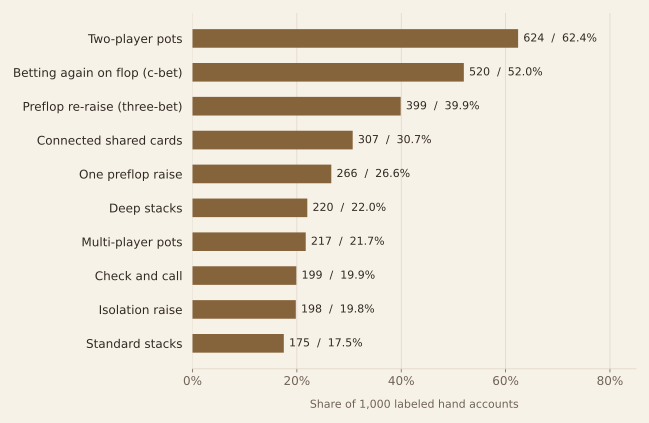
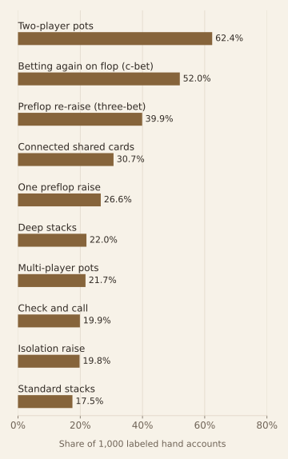
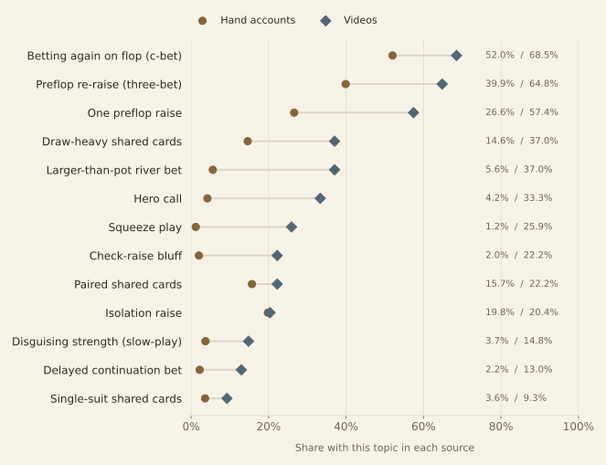
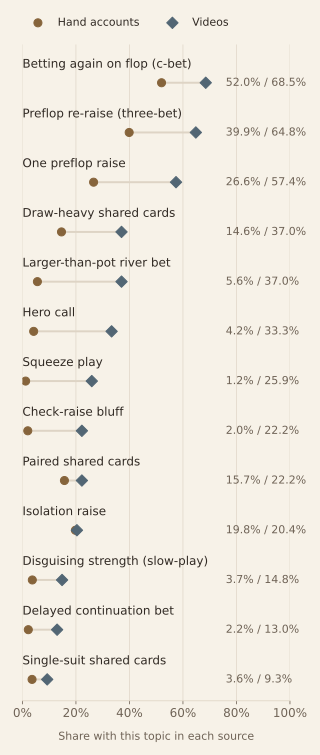
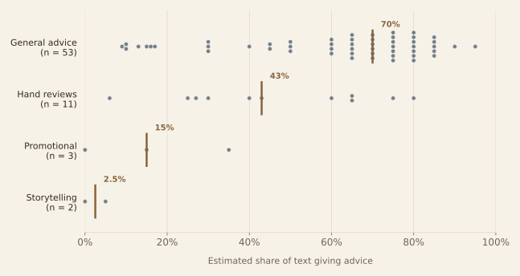
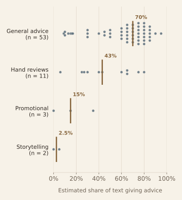

# What players discuss—and what videos teach

**Descriptive findings · November 2026 reanalysis of the original 2025 extraction**

The two sources share a focus on common betting decisions, but they give some topics very different amounts of attention. Video format also matters: videos labeled as general advice tend to receive higher estimates of advice content than reviews of individual hands.

These findings describe the material collected for this project. They tell us **what appears in the discussions and videos**, rather than whether the advice improved anyone's decisions.

<strong>A quick guide</strong>
A <em>hand</em> is one round of poker; a <em>hand account</em> is a player's description of it. The <em>pot</em> is the money players are competing for. The first three shared cards are the <em>flop</em>, followed by the <em>turn</em> and <em>river</em>. A topic label identifies a situation in an account or video, such as a particular kind of bet.

## 1. The discussions return to common betting decisions

**About six in ten labeled hand accounts involve two players. About half include a continuation bet on the flop**—when the player who raised before the first shared cards bets again after those cards arrive. Roughly four in ten involve a preflop re-raise, known as a three-bet pot.

These labels describe the decisions and settings that recur in the collected stories. One story can involve two players, a re-raise and a continuation bet at the same time.

<strong>How to read this chart:</strong> A longer bar means the topic appears in more hand accounts. A value of 52% means 520 of the 1,000 accounts with topic labels contain that topic. Categories can overlap.

<figure class="analysis-figure"><figcaption><strong>Figure 1.</strong> The ten most frequent topics among 1,000 hand accounts with model-assigned topic labels. Each account counts once per topic. Labels are shortened for readability; exact counts and original topic names are available in the aggregate download.</figcaption></figure>

**What this means:** the project provides a map of recurring situations to investigate—for example, whether the advice about betting again changes with the shared cards. These frequencies describe what people chose to post, not how often the situations happen in all poker play. A frequent label is also not evidence of a frequent mistake.

Poker terms used in this chart

<strong>Connected shared cards</strong> are close in rank, making a possible straight relevant. <strong>Deep stacks</strong> mean players have a large amount left to bet relative to the blinds, the required starting bets. <strong>Check and call</strong> means passing the chance to bet, then matching an opponent's bet. An <strong>isolation raise</strong> aims to narrow the field, often to one opponent. “Standard stacks” is a saved model label; it is not a separately verified chip threshold.

## 2. The sources overlap, but their topic mix differs

**The three leading video topics also recur in the forum accounts:** continuation bets on the flop, pots with a preflop re-raise, and pots with just one preflop raise. A continuation bet appears in 37 of the 54 videos with topic labels—about two-thirds—compared with about half of the labeled hand accounts.

<strong>How to read this chart:</strong> Each row is one topic. The circle marks its share of hand accounts; the diamond marks its share of videos. A wider gap means the topic takes up a different share of the two collections. Percentages make the differently sized samples comparable; they do not make the samples representative of all poker content.

<figure class="analysis-figure"><figcaption><strong>Figure 2.</strong> How often each shared topic appears among 1,000 labeled hand accounts and 54 labeled videos. Circles and diamonds distinguish the sources in addition to color. Right-hand values list the hand-account percentage, then the video percentage.</figcaption></figure>

One striking example is a **river overbet: a bet larger than the pot on the final betting round**. It appears in 20 of 54 labeled videos (37.0%), compared with 56 of 1,000 labeled hand accounts (5.6%). Isolation raises, by comparison, appear in about one-fifth of each sample: 20.4% of videos and 19.8% of hand accounts.

**What this means:** the selected videos and discussions share subjects, but their balance of topics differs. The river-overbet gap is a reason to inspect the underlying content, not a measure of too much teaching or too little demand. The videos come from one channel, and their labeling instructions offered a narrower topic vocabulary. Both choices can affect the apparent gaps.

More poker terms in the comparison

<strong>Draw-heavy cards</strong> offer several ways to complete a straight or flush. <strong>Paired shared cards</strong> include two cards of the same rank; <strong>single-suit cards</strong> share one suit. A <strong>hero call</strong> is a call with a relatively weak hand on the belief that the opponent is bluffing. A <strong>squeeze</strong> is a re-raise after a raise and one or more calls. A <strong>check-raise bluff</strong> passes, then raises an opponent's bet as a bluff. <strong>Slow-playing</strong> disguises a strong hand by playing it less aggressively. A <strong>delayed continuation bet</strong> waits until a later round to follow up the earlier raise.

Exact counts for the shared topics

| Canonical topic | Hand records / 1,000 | Videos / 54 |
|---|---:|---:|
| c-bet-flop | 520 | 37 |
| three-bet-pot | 399 | 35 |
| single-raised-pot | 266 | 31 |
| draw-heavy-board | 146 | 20 |
| overbet-river | 56 | 20 |
| hero-call | 42 | 18 |
| squeeze | 12 | 14 |
| check-raise-bluff | 20 | 12 |
| paired-board | 157 | 12 |
| iso-raise | 198 | 11 |
| trap-slowplay | 37 | 8 |
| delayed-c-bet | 22 | 7 |
| monotone-board | 36 | 5 |

## 3. General-advice videos contain more direct recommendations

Some videos explain what to do; others spend time walking through what happened in a particular hand. The saved model estimates reflect that difference: **the middle estimate is 70% advice for general-advice videos and 43% for hand reviews**. “Middle” means the median: half the group's estimates fall at or below it and half at or above it.

The model was asked to estimate the share of transcript lines that give explicit advice. A 70% estimate means it judged roughly seven in ten lines to contain advice. These are estimates from the original extraction, not a manual count or a measure of teaching quality.

<strong>How to read this chart:</strong> Each dot is one video. Farther right means a larger estimated share of advice. The brass line marks the middle of each group. Dots spread across the row show that videos of the same type can still differ substantially.

<figure class="analysis-figure"><figcaption><strong>Figure 3.</strong> Each dot represents one video's saved estimate; repeated values are stacked vertically. Brass lines mark group medians. The model was asked to estimate the percentage of transcript lines containing explicit advice. These are model estimates, not independently counted line proportions.</figcaption></figure>

**What this means:** the format label gives some indication of how much direct advice the model found, but there is plenty of overlap. General-advice estimates range from 9% to 95%; hand-review estimates range from 6% to 80%. A viewer looking for recommendations could still find an advice-heavy hand review or a general-advice video with relatively little explicit advice.

The comparison includes 53 general-advice videos and 11 hand reviews. The three promotional videos and two storytelling videos are shown for completeness, but are too few for a broad conclusion. The same model assigned both the type and the advice estimate, so this pattern needs independent checking before it could be used as a reliable guide. Nothing here measures whether viewers learned from a video or changed their play.

## What these findings can—and cannot—tell us

The practical value is a more focused starting point for learning and content review. A creator could inspect the hand accounts behind a recurring topic and choose examples for a lesson. A learner could compare several accounts of the same decision instead of browsing unrelated stories. Those are potential uses of the organized records, rather than outcomes tested by this project.

The river-overbet gap offers a concrete next question: does this creator emphasize a specialized situation, or do differences in labeling explain some of the gap? Reading and manually checking a sample from each source would help answer it. This is the kind of follow-up the topic map makes possible.

The findings do not establish which poker strategy wins, whether a creator's advice is correct, or whether forum users watched the videos.

Sample sizes and labeling limits

The forum comparisons use <strong>1,000 hand records with topic tags</strong>, from a collection of 1,003 threads. The video comparisons use <strong>54 videos with topic tags</strong> from Live Poker Guide; the advice chart uses all <strong>69 videos with label records</strong>. Missing topic tags are excluded from the topic percentages, rather than treated as evidence that a topic is absent.

The forum labels span 262 common topic names. Video labels span 13, all shared with the forum. The video prompt supplied those 13 example topics, while the forum prompt allowed a wider vocabulary. These different instructions limit how far topic comparisons can be generalized. The model-generated labels have not been independently checked against human annotations.

## What changed in the analysis

The original notebook explored six views, including frequency gaps, tone, advice “uptake,” perceived mistakes, outcomes, and cards. This edition concentrates on three descriptive views whose units can be made explicit from the saved data.

The new topic calculations use distinct hand–topic and video–topic pairs, removing the reply weighting in the original helper table. The cross-source comparison uses percentages within each source. The advice figure uses each labeled video once, avoiding a claim of exposure or adoption that the data cannot establish. One exact duplicate hand record is merged in the analysis copy, with original files preserved.

The remaining uncertainty is chiefly in what was collected and how the original models labeled it. No independently annotated validation sample was found, so the findings remain descriptions of the extracted dataset. The [pipeline and methods](METHODS.md#check-coverage-and-counting) document coverage, duplication, and the treatment of each original exploration.

## Inspect the evidence

The [topic counts](../data/topic-prevalence.csv), [advice-estimate frequencies](../data/advice-estimates.csv), and [inventory and checks](../data/summary.json) support the figures above. The [analysis](../scripts/analyze_saved_data.py) and [plotting](../scripts/plot_report.py) scripts document the calculations. Aggregate downloads contain no copied posts, transcripts, usernames, or source-record identifiers.

[Explore the pipeline →](METHODS.md) · [Return to the overview](../README.md)
