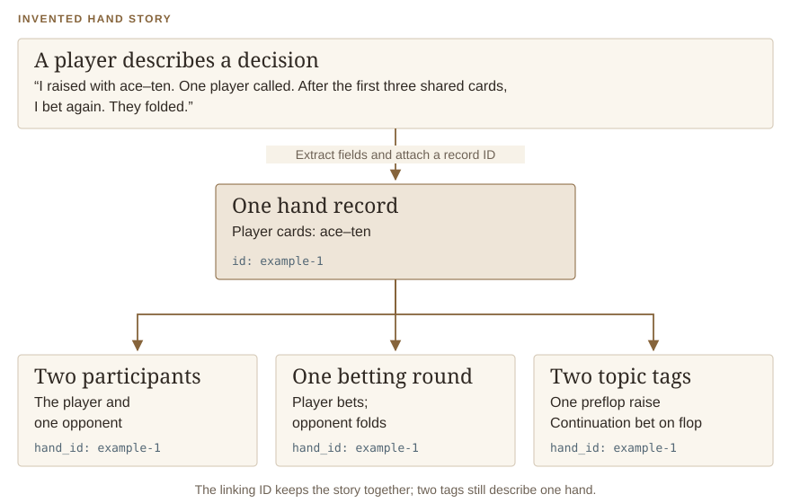
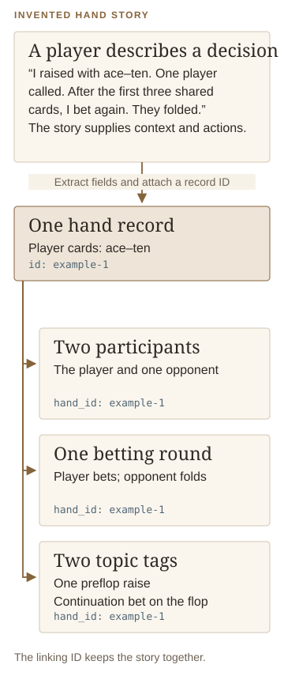
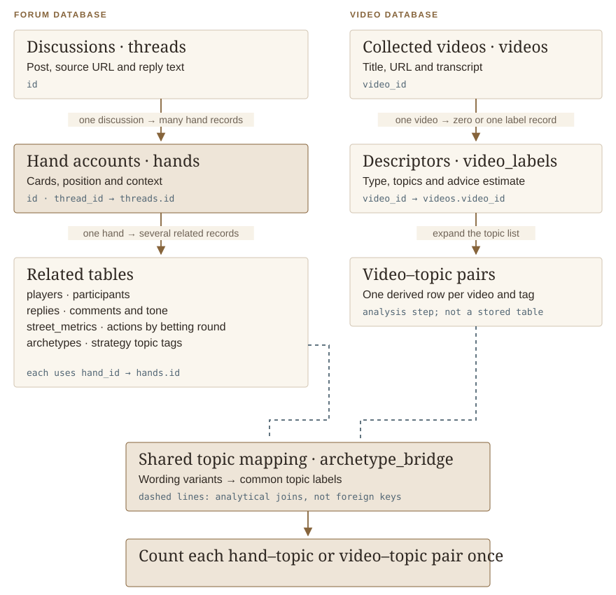
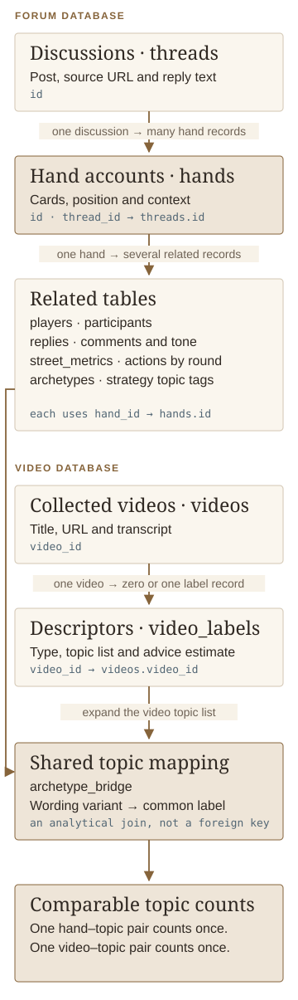

# Building the analytical dataset

**Collection, structured extraction, relational modeling, and reproducible analysis**

The core challenge was to turn poker stories into information that could be compared without losing their context. One discussion can describe several hands; one hand can involve several players; one video can cover several topics. The diagrams below show how the project keeps those relationships together. Technical details follow each explanation.

## Collect and prepare the text

The forum scraper uses **Requests and Beautiful Soup** to navigate a range of board pages, discover thread links, and parse the original post and replies. It normalizes URLs around the thread identifier and uses a unique URL constraint to avoid storing the same discussion twice.

The HTML contains information that needs deliberate handling. The scraper converts suit icons into text, separates quoted material from a reply's own content, and records whether the reply came from the original poster. It stores the collected text and reply JSON alongside the source URL and collection timestamp.

The video workflow enumerates a playlist, retrieves available transcript segments with language fallbacks, and saves the raw segments as JSON. A separate preparation step uses GPT-4.1 to correct transcription errors and punctuation. Raw and prepared transcripts are retained separately. The saved collection contains 75 videos from **Live Poker Guide**.

<details class="method-note"><summary>Collection boundaries</summary><p>The forum scraper follows board pagination; the reviewed implementation does not follow pagination within an individual discussion. The saved corpus is therefore a collection of captured discussions, not a verified census of every reply. Transcript preparation permits filling apparent gaps, so prepared text is a model transformation of the raw transcript. The later video-labeling step uses at most the first 32,000 characters; three stored transcripts exceed that length.</p></details>

## Convert narratives into related records

Instead of treating an entire discussion as one block of text, the project separates who was involved, what happened and which topics apply. A shared reference number connects those pieces back to the same hand. This simplified example shows the intended transformation.

<figure class="analysis-figure diagram-figure"><figcaption><strong>Figure M1 · From story to records.</strong> An invented example of the intended representation, not a corpus quotation or a new model response. The example ID is for illustration; stored hand IDs are numeric. Having two topic tags does not turn this into two hands.</figcaption></figure>

The extraction prompts ask o4-mini for structured JSON: named fields that the program can read consistently. On the forum side, the output describes hands, participants, strategy topics, actions by betting round, and comments. It includes position, stack size, shared-card patterns, and known private cards. The prompt tells the model to leave unknown cards empty and to distinguish applicable from inapplicable numerical fields.

On the video side, extraction assigns a content type, strategy topics, an estimate of how much text gives advice, and a sentiment label. Requiring JSON gives the loader a consistent representation to process; the accuracy of those fields still depends on the model's interpretation.

The implementation also normalizes card notation and JSON-encodes composite values before inserting them into SQLite. The later forum processor limits concurrent extraction requests to four and commits completed threads individually. It records the model and estimated token cost per thread and includes handling for rejected inputs. The video loader skips videos that already have labels and limits concurrent work to five tasks.

These features show the work involved in running the extraction across a collection. The [data-quality review below](#check-coverage-and-counting) describes limitations found in the saved implementation and its outputs.

## Design the relational model

The forum database has six core tables. `threads` stores the source discussions; `hands` links extracted hand accounts back to their discussion; `players`, `replies`, `street_metrics`, and `archetypes` attach related records to a hand. The video database separates collected videos from their extracted descriptors.

Think of the database as linked sets of index cards. A discussion card points to its hand accounts; each hand points to its participants, comments and actions. A record ID is the reference number that lets the program find the matching card. The shared topic dictionary then lets the two databases recognize equivalent labels.

<figure class="analysis-figure diagram-figure"><figcaption><strong>Figure M2 · How the records connect.</strong> Simplified actual schemas, with readable names followed by table names. The shared topic mapping contains 284 wording variants and 262 common labels. Connections to that mapping are analytical joins, not declared foreign keys between databases.</figcaption></figure>

This structure keeps the units visible. A player row describes a participant in a hand, not a unique person across the corpus. A strategy label describes a feature of a hand, not an additional hand. A reply can be related to a hand without becoming a new hand-level observation.

## Align topic vocabulary

The bridge builder gathers labels from both databases and asks a model to group equivalent wording into concise canonical topics. For example, the stored mapping aligns `4bet-pot` with `4-bet-pot`, and `check-behind-flop` with `check-back-flop`. The alias is retained so a grouping can be inspected.

The forum prompt allows an open-ended vocabulary. The video prompt supplies 13 example archetypes, and the saved video labels use those 13 canonical topics. All 13 occur in the forum, whose vocabulary spans 262 canonical labels. This matters when interpreting overlap: a missing video label can reflect the prompt and sample, as well as the underlying content.

The original notebook attaches the forum database to the video database in SQLite, expands JSON topic arrays with `json_each`, and joins labels through the bridge. The revised analysis retains the saved mapping and gives each hand–topic or video–topic pair one contribution to its topic count.

## Check coverage and counting

The November 2026 reading edition audits the saved data before plotting it. It merges only exact duplicate hand records: every stored field except the surrogate ID must match, including the source thread. One such duplicate is merged, reducing 1,037 stored records to **1,036 distinct extracted hand records**. Child associations are mapped to the retained ID. This does not establish that every remaining account describes a unique real-world hand.

| Stage | Records available | Role in the revised analysis |
|---|---:|---|
| Collected forum threads | 1,003 | Source inventory |
| Threads with extracted hands | 982 | Extraction coverage |
| Distinct extracted hand records | 1,036 | Hand-level base after exact duplicate removal |
| Hand records with topic tags | 1,000 | Forum topic denominator |
| Collected videos | 75 | Source inventory |
| Videos with label records | 69 | Advice-density and content-type sample |
| Videos with topic tags | 54 | Video topic denominator |

The remaining 36 hand records and 15 labeled videos without topic tags are excluded from topic denominators. Six collected videos have no label record. Missing tags are not interpreted as absence of all topics.

<details class="method-note"><summary>Duplicate replies and the original joins</summary><p>The saved replies table contains 13,877 rows but 4,280 distinct combinations of hand, author, text, original-poster flag, and sentiment. The street table contains 8,172 rows but 3,460 distinct full tuples. These are duplication diagnostics, not reconstructed counts of real-world events.</p><p>The later forum loader inserts replies within its betting-round loop. It also inserts topics and betting-round records after the hand loop, using the final hand ID. A synthetic in-memory check reproduced repeated replies and missing child records for earlier hands in a multi-hand input. Historical runs may have used different versions; the audit does not attribute every stored duplicate to a single cause.</p><p>The original notebook's hand/topic/reply helper yields 75,163 rows. The corrected topic analysis avoids that join entirely. It counts 5,063 distinct hand–topic pairs and 230 distinct video–topic pairs. No reply count can increase a hand's weight within a topic. The original loader and data have not been repaired or rerun.</p></details>

For a topic <em>t</em>, the plotted percentage is:

<div class="formula">100 × records tagged with <em>t</em> ÷ records with at least one topic tag</div>

Records can carry several topics, so the percentages across topics can exceed 100% in total. The two source denominators remain separate. The advice-density plot uses one stored label record per video, displays all 69 estimates, and summarizes them by the model-assigned content type.

<details class="method-note"><summary>How the new figures relate to the original notebook</summary><table><thead><tr><th>Original exploration</th><th>Reading-edition treatment</th></tr></thead><tbody><tr><td>Frequency gap</td><td>Replaced with within-source topic percentages using distinct hand/video pairs. No “underserved demand” interpretation.</td></tr><tr><td>Tone alignment</td><td>The original query chooses one matching video per topic. That output is retained in the original notebook but is not presented as a creator-wide average.</td></tr><tr><td>Advice density versus uptake</td><td>Reframed as a distribution of saved advice estimates by video type. No viewing or adoption data were collected.</td></tr><tr><td>Mistake rates and Sankey flows</td><td>Retained as original explorations. Nonempty mistake text is not a verified error, and the Sankey counts hand–topic rows rather than independent hands.</td></tr><tr><td>UTG card heatmap</td><td>Retained in the original files. The query filters position rather than identifying a complete set of opening decisions, so it does not support a population opening-range estimate.</td></tr></tbody></table></details>

## Reproduce the reading edition

The [new analysis script](../scripts/analyze_saved_data.py) uses the Python standard library. It copies each database and any WAL/SHM sidecars to a temporary directory, opens the copies read-only, and writes only aggregate outputs to the report package. SHA-256 checks verify that the original databases, sidecars, and notebook did not change during analysis. The [synthetic checks](../scripts/test_analysis.py) verify the counting rules without accessing the corpus.

Recomputing from the source requires the private original databases. The public [aggregate data](../data/) is sufficient to reproduce the three analytical charts with the [plotting script](../scripts/plot_report.py), Matplotlib, and NumPy. The [diagram script](../scripts/draw_diagrams.py) uses only the Python standard library to draw the three workflow explanations. Building the reading pages requires Python 3.10 or newer and Pandoc or Quarto. No API key is required for these steps.

```sh
# Optional: recompute aggregates if you have the original project locally.
python3 scripts/analyze_saved_data.py --source-root /path/to/304-Final

# Verify counting rules, redraw figures, and build the reading site.
python3 scripts/test_analysis.py
python3 scripts/plot_report.py
python3 scripts/draw_diagrams.py
python3 scripts/check_site_files.py
python3 scripts/build_portfolio_site.py
```

The report build does not execute the original notebook or extraction code. The source databases, notebook, and six original figures remain preserved. The new figures and aggregate analysis are a separately identified, AI-assisted 2026 extension.

[Read the findings →](FINDINGS.md) · [Return to the overview](../README.md)

